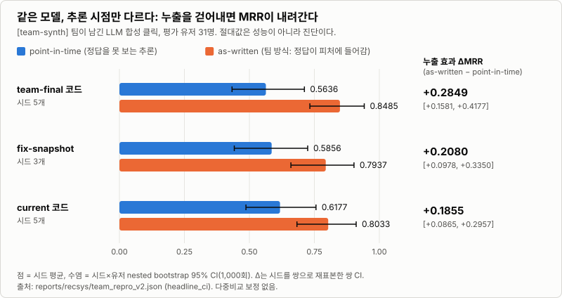
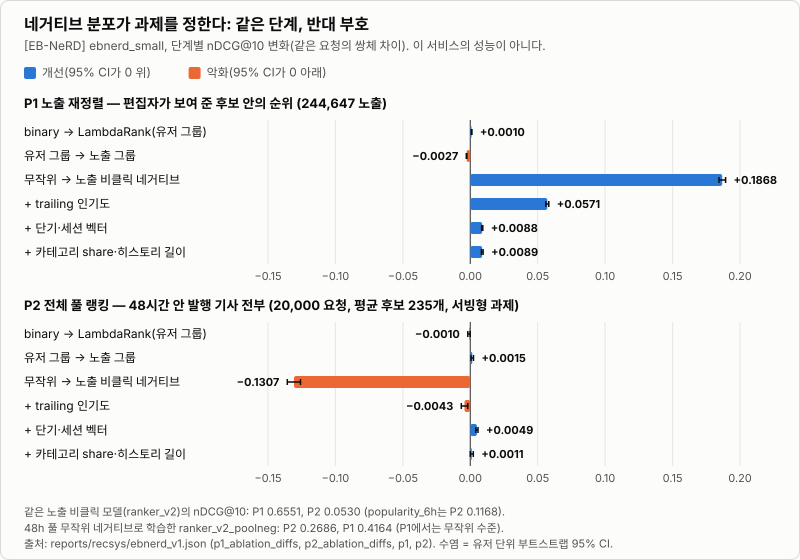
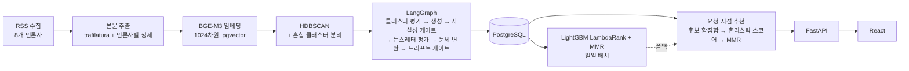
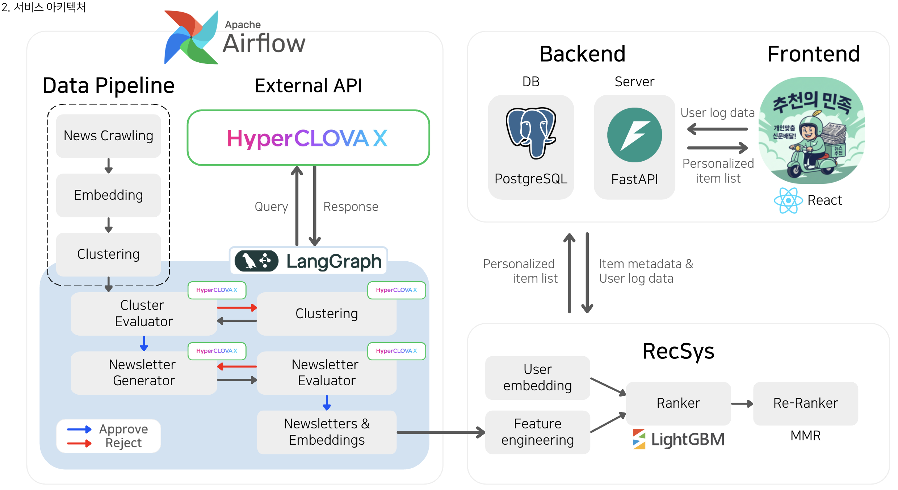

# 한국어 뉴스레터 추천·생성: 평가·서빙·LLM 실측 인프라를 다시 세운 fork

[](https://github.com/khj1212k/pro-recsys-finalproject-recsys-01/actions/workflows/ci.yml)

한국 언론사 RSS 기사를 모아 같은 사건끼리 묶고, LLM으로 사건별 뉴스레터를 쓰고, 사용자별로 순위를 매겨 보여 주는 파이프라인이다. 네이버 부스트캠프 AI Tech 8기 RecSys 트랙 5인 팀 프로젝트(2026.01–02, 팀이 끝난 시점은 [`team-final` 태그](https://github.com/khj1212k/pro-recsys-finalproject-recsys-01/tree/team-final), 커밋 `ef7c176`, 2026-02-10)를 fork해, 팀이 끝난 뒤 김형준([@khj1212k](https://github.com/khj1212k))이 혼자 평가 프로토콜, 서빙 경로, LLM 생성 실측 인프라를 다시 세웠다. 팀 시절의 추천 모델과 합성 데이터셋은 팀원의 작업이다([팀 소개](#팀-소개)). **배포된 사용자 서비스는 없고 실사용자도 없다.** 상시 도는 것은 1 GB 무료 VM의 수집기와 호스트 밖 백업뿐이다. 아래 '한눈에 보는 결과'의 수치는 모두 데이터 라벨이 붙은 오프라인 측정이고, 이 서비스의 성능이 아니다. 라벨: [team-synth] 팀이 남긴 LLM 합성 클릭, [EB-NeRD] 덴마크어 공개 뉴스 클릭 로그, [CI-synth] CI 테스트 DB의 합성 데이터, [KR-E0] 한국어 수집 기사 15클러스터, [KR-embed] 한국어 수집 기사의 임베딩 점검(정의는 [증거 요약표](docs/evidence-summary.md#읽는-법)).

## 한눈에 보는 결과

가장 강한 세 가지:

- **팀 평가 지표의 누출을 규명했다** [team-synth]. 같은 모델의 추론 시점만 바꾸면 팀 최종 코드의 MRR이 0.8485 → 0.5636이다(차이 +0.2849, 95% CI [+0.1581, +0.4177], 5 seed, 평가 유저 31명). 절대값은 성능이 아니라 진단이다. [케이스 01](docs/case-studies/01-team-metric-leakage.md) · [리포트](reports/recsys/team_repro_v2.md)
- **학습 네거티브 분포가 과제를 정한다는 것을 사전 등록한 ablation 사슬로 쟀다** [EB-NeRD]. 노출 재정렬 nDCG@10은 0.3952 → 0.6551이지만 개선의 대부분은 학습 네거티브에서 왔고(+0.1868 [+0.1844, +0.1893]) LambdaRank 교체는 +0.0010이다. 같은 모델이 전체 후보 풀에서는 0.0530으로 popularity_6h(0.1168)보다 낮다. 사슬과 해석 규칙은 사전 등록이고 '대부분이 네거티브에서 왔다'는 읽기는 결과를 본 뒤의 서술이다. [케이스 02](docs/case-studies/02-negatives-define-the-task.md) · [리포트](reports/recsys/ebnerd_v1.md)
- **LLM 생성 파이프라인을 2월 이후 처음 실제 기사로 완주해 쟀다** [KR-E0]. 15클러스터 중 14 생성, 첫 시도 스키마 통과 72/72, 클러스터당 중앙값 9.3초, 총 $0.155614. 사람 라벨 없이 자동 라벨러 기준 발행 가능률 11/15 = 0.733 [0.480, 0.891]이고 라벨러의 정확도는 재지 않았다. [케이스 03](docs/case-studies/03-first-llm-measurement.md) · [리포트](reports/llm/e0_baseline_v1.md)

그 밖에:

- **사전 등록한 신경망 비교에서 신경망이 튜닝한 LightGBM을 넘지 못했고, 그대로 기록했다** [EB-NeRD]. NRMS-lite − 튜닝한 LightGBM = −0.0215 [−0.0224, −0.0206](노출 재정렬), −0.0531 [−0.0562, −0.0498](전체 풀). 판정 4개 모두 `seed_rule_failed`(우위 입증 실패)이고 점추정과 CI는 모두 0 아래다. 범위는 [EB-NeRD]·NRMS-lite 한정이다. [리포트](reports/recsys/ebnerd_v1_3_neural.md) · [ADR 0013](docs/adr/0013-ranker-v2-design.md)
- **train/serve parity를 CI 게이트로 만들었다** [CI-synth]. 서빙이 남긴 22열 피처와 오프라인 재계산이 max\|Δ\| 1.19e-7, 요청 198건의 순서 τ = 1이고, 첫 실행은 0.0397 어긋남(마이크로초 순서)을 잡았다. 모델은 무작위 데이터라 추천 품질이 아니다. [리포트](reports/recsys/parity_v1.md) · [ADR 0033](docs/adr/0033-train-serve-feature-parity.md)
- **한국어 임베딩이 주제 구조를 담는지 점검했다** [KR-embed]. BGE-M3 섹션 kNN leave-one-out 정확도 0.7519 [0.7328, 0.7725] 대 다수 클래스 0.4640(n = 1,890). 클릭 예측력이 아니다. [리포트](reports/kr/embedding_check_v1.md)

<p align="center">
  
</p>
<p align="center">
  
</p>

## English TL;DR

This repository is a fork of a five-person capstone (Naver Boostcamp AI Tech 8, a Korean news newsletter recommender and LLM generator; the team's final state is the [`team-final` tag](https://github.com/khj1212k/pro-recsys-finalproject-recsys-01/tree/team-final), commit `ef7c176`). After the team project ended, the owner rebuilt the evaluation, serving and LLM-measurement layers alone. Highlights: the team's recommender metric was inflated by inference-time leakage (MRR 0.8485 as written vs 0.5636 point-in-time; inflation +0.285, paired 95% CI [+0.158, +0.418]; synthetic team data, team-synth); on the public EB-NeRD benchmark, a preregistered ablation chain (read descriptively after the fact) shows most of the ranker gain comes from the training-negative distribution, not the model, and a tuned NRMS-lite neural user encoder did not beat tuned LightGBM (EB-NeRD only; preregistered verdict `seed_rule_failed`); a CI gate checks train/serve feature parity (max abs diff 1.19e-7, CI-synth data); and the generation pipeline was run end to end on 15 real Korean news clusters (14 produced a newsletter, KR-E0) for $0.16, scored by an automated labeler because no human labels exist. This is not a deployed service: there are no real users and no Korean click data, and every headline number carries a data label.

## 읽기 경로

이 문서의 위쪽과 [케이스 01](docs/case-studies/01-team-metric-leakage.md)만 읽으면 약 15분, 아래 셋을 모두 읽으면 약 40분이다.

1. [케이스 스터디 3편](docs/case-studies/README.md): 각 2~3쪽, 문제 → 가설 → 측정 설계 → 결과 → 결정 → 한계.
2. [증거 요약표](docs/evidence-summary.md): 주장 8개 × 데이터 출처 × 증거 등급 × 수치와 CI × 한계, 음성 결과와 철회.
3. [ADR 색인](docs/adr/README.md): 결정 기록. 긴 ADR(0013 등)은 상태 문단과 결과 절만 먼저 읽는다.

## 이 저장소가 주장하지 않는 것

아래는 [ADR 0009 A9](docs/adr/0009-llm-eval-protocol-and-preregistered-decision-rule.md) 5항과 [범위 종결](docs/design/2026-10-18-scope-closure.md)의 판정을 따른 목록이다. 이 문장들은 쓰지 않는다.

- 배포·운영 중인 추천 서비스, 실사용자 CTR 개선, 한국어 서비스의 추천 성능. 한국어 클릭은 0건이다. [EB-NeRD]·[team-synth]·[SIM]의 어떤 수치도 이 서비스의 성능이 아니다.
- "검증된 랭커가 서빙 중이다", "shadow로 서빙 경로에 올렸다". 등록된 랭커는 0개이고 목록은 휴리스틱이 만든다([ADR 0014](docs/adr/0014-active-heuristic-scorer-v2.md), [0037](docs/adr/0037-ebnerd-shadow-model-registration.md): 등록 도구와 테스트까지).
- "GBDT가 신경망보다 낫다"는 일반 주장. 비교는 [EB-NeRD]와 NRMS-lite(고정 BGE-M3 투영) 한정이다.
- "LLM 평가(bake-off)로 모델을 선정했다", "모델 X가 Y보다 낫다". bake-off v1은 유보다(사람 라벨·교차 계열 judge 키 없음, 범위 동결). 현행 기본 모델은 선정이 아니라 기본값이다.
- "사람이 라벨링한/검증한 발행 가능률·품질", "judge를 사람 라벨로 보정했다", "교차 계열 judge로 검증했다". 사람 라벨이 한 건도 없고 라벨러·생성기·judge가 모두 Gemini 계열이다.
- "사실성 게이트의 정밀도·재현율", "게이트로 환각을 차단한다". 사람 정답 대비 값이 없고, 게이트는 수치·인용 한정이며(날짜는 대조하지 않고 개체명은 참고), judge는 기록만 한다.
- 한국어 전이 확인. 한국어 kNN은 주제 구조 점검이다.
- 배포 대상 장비·HTTP 수준의 응답 시간·처리량·부하 수치. 요청 경로 지연은 합성 데이터·CI 러너에서 잰 값만 있고(아래 '측정한 것'), 나머지는 A1을 확보한 뒤로 유보했다.
- "수집이 안정적으로 운영 중이다", "본문 보존 잡이 본문을 비웠다", "백업이 검증됐다". 정시 회차 성공률은 기준에 못 미쳤고 재배포(10-18) 뒤 7일을 본 뒤 다시 확인한다. 보존 잡의 첫 실행은 10-26이다. 백업은 손으로 한 백업 1회·복원 검증 2회까지만 말할 수 있다(ADR 0026).
- 팀 시절 추천 모델·합성 데이터셋의 소유, 팀 보고 MRR 0.897의 재현이나 설명.

---

## 현재 상태 (2026-10-18 기준, 수집·데이터 정책 행의 수치는 2026-10-17 기준, 재배포·승인은 10-18)



그림은 코드에 있는 경로다. 실제로 상시 도는 곳은 수집기 하나이고, 사용자가 쓰는 서비스로 배포된 곳은 없다(2026-10-18 기준): OCI Always Free VM(1 GB, [ADR 0026](docs/adr/0026-hosting-tiers-and-contingency.md))의 스케줄러가 `docker/crontab.micro`의 수집(RSS → 본문 추출, 매시)·인기도·일일 리포트·본문 보존(매일) 네 잡을 돌리고, VM 호스트의 cron이 매일 DB를 OCI Object Storage로 백업한다. 이 VM은 2026-10-18 06:29~06:32 UTC에 main `e9864cf`로 다시 배포했다([범위 종결 C-29](docs/design/2026-10-18-scope-closure.md)). 임베딩·클러스터링·생성은 어디에서도 상시 돌지 않는다 — 이 VM에서는 메모리가 모자라고, 전체 compose용 `docker/crontab`(임베딩·클러스터 통계 포함)을 띄운 호스트는 지금 없다. `generate`, `batch_fallback` 잡은 `docker/crontab`에서 꺼져 있다. 팀 시절의 학습 잡 `train`은 은퇴했고(불려도 아무것도 실행하지 않는다) `user_embed` 잡은 없앴다 - 장기 프로필은 클릭마다 갱신되는 상태다 ([ADR 0033](docs/adr/0033-train-serve-feature-parity.md)).

| 영역 | 지금 있는 것 | 아직 없는 것 |
|---|---|---|
| 수집 | RSS UPSERT, 재시도, 언론사별 본문 정제, docker compose + supercronic 잡 런타임과 실행 기록(`job_runs`), 본문 해시 중복 제거 ([ADR 0006](docs/adr/0006-runtime-compose-and-scheduler.md)), 정책브리핑 Open API 수집기 ([ADR 0023](docs/adr/0023-data-sources-copyright-retention.md)). Tier 0 VM 단독 수집(2026-09-26부터, 10-17 `news_raw` 31,097행), 호스트 밖 백업(VM 호스트 cron이 매일 18:10 UTC에 본문 없는 사본, 설정으로 켠 기계에서는 최근 27일 본문 사본도 올린다. 첫 스케줄 실행은 10-17이고 손으로 한 백업 1회·복원 검증 2회가 있다. "매일" 성공률과 28일마다의 자동 복원 검증은 아직 판단하지 않았다), 일일 리포트의 정시 회차·백업 경과·유휴 회수 위험 줄 ([ADR 0026](docs/adr/0026-hosting-tiers-and-contingency.md) 결정 6). **2026-10-18**: Tier 0을 main `e9864cf`로 재배포했다(Alembic 변경 없음, 스케줄러 중단 약 3분). 결정 9 코드(요청 상한·언론사별 차단기·추출 마감·RSS 소켓 상한)와 백업 스크립트의 main 판이 들어갔다. 소유자가 본문 사본 `full/`(ADR 0023 개정 2)을 승인했고 07:08 UTC에 VM 설정에서 켰다 ([범위 종결](docs/design/2026-10-18-scope-closure.md) C-29·C-36) | 정시 회차 기준 95% 수집(09-26~10-06에 233회 중 198회 성공 85.0%, 27회는 앞 회차가 1시간을 넘겨 시작되지 않았다 - ADR 0026 증거 8. 재배포 뒤의 성공률은 아직 측정하지 않았고, "1시간 초과 회차가 없어진다"는 계산이지 측정이 아니다), 재배포 뒤 확인(첫 정시 ingest, 18:10 UTC 백업, 새 일일 리포트 줄. 진행 중, 범위 종결 C-29), `full/` 수명 주기 삭제의 확인(유보: 소유자의 확인 일정 10-20·10-25 무렵, C-32), 정책브리핑 실제 수집(인증키 발급 전이라 0건), 동아일보 수집 방침(소유자 결정) |
| LLM | OpenAI 호환 어댑터 하나로 Gemini·Upstage·OpenAI 호출, 요청 타임아웃 60초·호출당 deadline 180초, 킬 스위치 ([ADR 0005](docs/adr/0005-llm-provider-abstraction.md)), 요청 전에 최악 비용을 원장에 예약해 런·일·전체 상한에서 멈추는 지출 가드와 런 서킷브레이커 ([ADR 0035](docs/adr/0035-llm-spend-cap-in-client-ledger.md)). **E0 기준선(2026-10-17)**: main 생성 파이프라인을 코드 그대로 실제 수집 기사 15클러스터에 돌려 14 생성, 첫 시도 스키마 72/72, 클러스터당 중앙값 9.3초, 비용 $0.155614로 원장 합과 응답 usage 합이 같았다 ([e0_baseline_v1](reports/llm/e0_baseline_v1.md)). 사람 라벨 자리는 자동 라벨러(gemini-3-flash-preview)가 채웠다 ([e0_auto_labels_v1](reports/llm/e0_auto_labels_v1.md), [ADR 0009](docs/adr/0009-llm-eval-protocol-and-preregistered-decision-rule.md) A8.12–A8.14). **정합 패치 M1 축소판(PR #48, 2026-10-18)**: 스키마 검증 실패 재시도는 2회(전송 계층 재시도와 따로 센다), 막힌 호출은 재시도 금지 목록으로 닫고(아래 생성 품질 행), `reasoning_effort`를 역할별 env로 보낼 수 있다(기본은 미설정. `gemini-3.5-flash-lite`는 `none`을 HTTP 400으로 거부했다 - 합성 입력 pre-flight n=1, [ADR 0005 부록](docs/adr/0005-llm-provider-abstraction.md)). E0는 이 변경 전 코드로 쟀고 다시 돌리지 않았다 | 사람 라벨(없음), 원장 금액과 청구액의 대조(E0는 "대조 불가"), 모델 선정(bake-off v1은 유보: 사람 라벨·교차 계열 judge 키가 없고 범위 동결이다. 현행 기본값 생성 `gemini-3.5-flash-lite`·judge v2 shadow `gemini-3.1-flash-lite`는 선정이 아니라 기본값이다 - [ADR 0009 A9](docs/adr/0009-llm-eval-protocol-and-preregistered-decision-rule.md)), 고친 코드로 다시 돌린 E0, 운영에서 도는 생성(`generate` 잡은 꺼져 있다), 스레드 사이 공유 서킷브레이커와 일일 생성 캡(뉴스레터 수 기준. 취업 전 계획에 없다 - 범위 종결 C-13) |
| 생성 품질 | LangGraph 안의 결정론적 사실성 게이트(수치·인용 한정. 날짜는 추출만 하고 대조하지 않으며 개체명은 참고)·문체 드리프트 게이트(제목·한줄소개·본문을 비교하고, 한줄소개는 PR #48이 더했다. 막는 유형은 그대로)와 judge v2(기록만 하는 shadow) (`ai_workspace/core/faithfulness.py`, [ADR 0010](docs/adr/0010-faithfulness-gate-and-judge-v2.md), 차단 유형·임계값은 잠정값). **재시도 금지**: 킬 스위치, HTTP 401/403/404, `length`, `content_filter`로 막힌 호출(클러스터 평가·생성·judge)은 다시 생성하지 않고 `skipped`가 아니라 `failure_reason`(`infra`/`length`/`content_filter`)으로 닫는다. HTTP 402도 목록에 있지만 운영 경로에서는 지출 가드가 런을 멈추므로([ADR 0035](docs/adr/0035-llm-spend-cap-in-client-ledger.md)) 그 분기는 가드를 우회한 테스트 대역에서만 돈다. 문체 변환 호출이 막히면 검증 재시도만 멈추고 결정론적 폴백 문장으로 저장한다. 페이크 전송 계층의 요청 수와 장애 주입 테스트로 확인한 동작이고, 실제 장애에서 줄어드는 비용·시간은 측정하지 않았다. **사용 기사 연결 범위**: 뉴스레터는 클러스터 평가를 거쳐 남은 기사만 `news_letter_id`로 연결한다(전에는 클러스터 원본 전체). 생성기가 프롬프트에 넣은 목록(본문이 긴 순 10개)과는 같지 않아서, 10개를 넘는 클러스터에서는 프롬프트에 없던 기사도 연결된다 ([ADR 0010 Addendum 2026-10-18](docs/adr/0010-faithfulness-gate-and-judge-v2.md)). 실제 생성물 기록(E0 첫 초안 14편, 변경 전 코드): 미지원 수치·인용 ≥1은 0/14, 문체 드리프트 차단 0/14, 분량 규칙 위반 11/14, judge v2 shadow 기본 임계값 PASS 4/14(생성기와 같은 Gemini 계열). 자동 라벨러 기준 발행 가능률 11/15 = 0.733 [0.480, 0.891], 사실 오류 ≥1 3/14([e0_auto_labels_v1](reports/llm/e0_auto_labels_v1.md)). 클러스터링 지표 함수(`evaluation/clustering/metrics.py`) | 사람 라벨로 보정한 품질·사실성 수치(라벨러 정확도도 미측정), 게이트의 정밀도·재현율(사람 정답 대비), 날짜 대조, judge 보정, 클러스터링 품질, 고친 코드로 다시 잰 생성 품질. 정합 결함 가운데 소스 준비·클러스터 선택 순서·날짜 대조 등 나머지 C 항목은 취업 전 계획에 없다([범위 종결 C-16](docs/design/2026-10-18-scope-closure.md)) |
| 추천(배치) | 팀 시절 LightGBM + MMR에 7월 셀프 리뷰 수정 반영 (시점 누출·그룹 정의·시드 등, [ADR 0003](docs/adr/0003-lightgbm-mmr-for-recommendation.md)·[0004](docs/adr/0004-continue-in-fork-and-port-july-fixes.md)) | 이 서비스의 사람 클릭으로 잰 추천 성능(실사용자가 없다) |
| 추천(요청 시점) | `GET /newsletters/today`를 API 프로세스 안에서 요청마다 계산한다. 후보 합집합 → 휴리스틱 스코어 → MMR, 시간 예산 300ms, 폴백(인기 → 최신. `RECSYS_MODE=batch`에서는 배치 행부터), 노출 로그 ([ADR 0015](docs/adr/0015-request-time-recommendation.md)). 활성 스코어러는 휴리스틱 v2다: [EB-NeRD]에서 적합한 가중치 (b) 세트와 6시간 클릭 인기도 항 ([ADR 0014](docs/adr/0014-active-heuristic-scorer-v2.md), 추천 품질 판정은 없다). 단기 사용자 상태는 클릭 로그에서 요청마다 계산한다 ([ADR 0017](docs/adr/0017-short-term-state-store.md)). 랭커의 피처는 오프라인 하네스와 같은 코드(`recsys_core`)로 만들고, 레지스트리에 등록된 모델은 요청 경로 밖에서 점수만 남긴다(shadow). 서빙이 남긴 피처가 같은 로그의 오프라인 재계산과 같은지는 CI가 요청 200건의 재생으로 본다 ([ADR 0033](docs/adr/0033-train-serve-feature-parity.md), [리포트](reports/recsys/parity_v1.md), 휴리스틱 v2 뒤 재실행 [parity_v1_m5](reports/recsys/parity_v1_m5.json)) | 추천 품질, 배포 대상 장비와 HTTP 수준의 지연, 한국어 데이터로 정한 가중치. **등록된 랭커 모델은 0개다**: EB-NeRD 랭커의 shadow 등록은 도구와 테스트까지이고([ADR 0037](docs/adr/0037-ebnerd-shadow-model-registration.md)) 서빙 API 배포가 없어 shadow 점수도 없다. parity 게이트가 쓰는 모델은 무작위 데이터로 만든 22열 모델이다 |
| 추천 평가 | 팀 베이스라인 재현 하네스와 오프라인 평가 프로토콜(point-in-time, 고정 정답 창, 베이스라인, 시드와 부트스트랩 신뢰구간, [ADR 0007](docs/adr/0007-recsys-offline-evaluation-protocol.md)). EB-NeRD 공개 벤치마크 하네스, point-in-time 피처 코어 `recsys_core`, ranker v2 설계와 사전 등록한 승격 규칙 R1–R4(통과. R1·R2는 ranker_v2, R3·R4는 풀 네거티브 변형으로 판정해 한 모델이 두 과제를 모두 넘은 것은 아니다, [ADR 0013](docs/adr/0013-ranker-v2-design.md)). 콜드 regime(A2, [ebnerd_v1_2_cold](reports/recsys/ebnerd_v1_2_cold.md)): shadow 주모델 `poolneg_mask0`, k\* = 0, 랭크 정규화는 **불충족**. E15 신경망 비교(A3, [ebnerd_v1_3_neural](reports/recsys/ebnerd_v1_3_neural.md)): 판정 4개 모두 `seed_rule_failed`, LightGBM 유지, 후속 없음([EB-NeRD]·NRMS-lite 한정). 한국어 임베딩 kNN 점검([embedding_check_v1](reports/kr/embedding_check_v1.md), 주제 구조일 뿐 클릭 예측력이 아니다) | 한국어 클릭 데이터로 한 ranker v2 검증(서빙은 shadow부터, 한국어 클릭은 0건), 팀 재현 리포트의 전체 재실행(폐기: 표본 대조 20회가 최종 증거이고 전체 재현이 아니다 - 범위 종결 C-01) |
| 시뮬레이터·부하 | 합성 사용자 시뮬레이터, Locust 부하 하네스, 사전 등록한 지표 타당성 격자 ([ADR 0019](docs/adr/0019-user-simulator-design-and-claim-scope.md)). 시스템 반응 지표만 보고 추천 정확도는 주장하지 않는다 | 부하 수치(유보: 배포 대상 A1을 확보한 뒤 - 범위 종결 C-04), drift 적응 지표의 타당성 |
| DB | pgvector 어댑터 등록, `news_raw` URL UNIQUE·timestamptz ([ADR 0008](docs/adr/0008-db-layer-pgvector-schema-and-upsert.md)), 노출 로그·모델 레지스트리 테이블과 요청 경로 인덱스 (ADR 0015) | — |
| 데이터 정책 | 출처별 라이선스 표와 본문 보존 원칙, 수집 후 30일이 지난 상업 언론사 본문을 매일 비우는 `retention` 잡(2026-10-17 Tier 0 배포, 첫 비움 10-26), E0 반출본과 라벨링 패키지의 본문 사본 삭제(2026-10-18 07:13 UTC. 해시·길이·제목·URL·임베딩은 남는다) ([ADR 0023](docs/adr/0023-data-sources-copyright-retention.md), [ADR 0009](docs/adr/0009-llm-eval-protocol-and-preregistered-decision-rule.md) A8.12·A8.14) | 실제로 비운 기록(첫 만료 전) |

LLM 호출은 HyperCLOVA X가 아니라 위 어댑터를 거친다. 팀 시절에 쓰던 HyperCLOVA X는 더 이상 쓸 수 없어서 교체했다([ADR 0005](docs/adr/0005-llm-provider-abstraction.md)).

## 측정한 것과 아직 측정하지 않은 것

측정했고 근거가 저장소에 있는 것:

- LLM 호출 프로브(2026-09-25, 각 1회): 생성 기본 모델은 정상 응답 1.8초, 판정 기본 모델은 8.1초. 한 후보는 30초 타임아웃과 연속 503이 나서 판정 기본값에서 뺐다 — [ADR 0005 부록](docs/adr/0005-llm-provider-abstraction.md). 표본이 1회씩이라 지연 분포로 읽으면 안 된다.
- 추론 시 사용자 히스토리 임베딩 메모이즈: 합성 데이터(사용자 300 × 뉴스 200)에서 수정 전 14.5~15.1초 → 수정 후 0.044~0.053초 — [ADR 0004](docs/adr/0004-continue-in-fork-and-port-july-fixes.md).
- 항상 0이던 사용자 속성 피처 2개 제거 전후 LightGBM 예측이 합성 데이터에서 비트 단위로 같음. 3시드 × 열 위치 3가지 × 학습 방식 2가지(early stopping, 트리 300개 고정) — [reports/recsys/constant_feature_ablation_v1](reports/recsys/constant_feature_ablation_v1.md), [ADR 0003](docs/adr/0003-lightgbm-mmr-for-recommendation.md).
- [team-synth] 팀 베이스라인 재현(팀이 남긴 합성 클릭 아카이브, 평가 유저 31명, 시드 5개): 같은 모델을 팀 방식 추론 시점과 point-in-time으로 추론하면 팀 최종 코드의 MRR이 0.8485 → 0.5636이 된다(차이 +0.2849, 95% CI [+0.1581, +0.4177]). point-in-time에서 인기도·온보딩 코사인·히스토리 코사인 베이스라인에 대한 모델 우위 신뢰구간은 없다. 절대 수치는 성능이 아니라 코드 결함이 지표를 움직이는 방향을 보는 진단이다 — [reports/recsys/team_repro_v2](reports/recsys/team_repro_v2.md), [ADR 0007](docs/adr/0007-recsys-offline-evaluation-protocol.md).
- [EB-NeRD] 덴마크어 공개 뉴스 클릭 로그(`ebnerd_small`) 오프라인 평가: 노출 재정렬 nDCG@10이 ranker v2 0.6551 [0.6533, 0.6569], 가장 강한 베이스라인 popularity_24h 0.5992, 팀 방식 재현 0.3952다. 이 서비스의 성능이 아니다 — [reports/recsys/ebnerd_v1](reports/recsys/ebnerd_v1.md), [ADR 0013](docs/adr/0013-ranker-v2-design.md).
- [EB-NeRD] 신경망 사용자 모델 비교(E15, 사전 등록·기계 판정): NRMS-lite − 튜닝한 LightGBM(신경망 family당 12 trial 대 24 trial)의 nDCG@10 차이가 노출 재정렬 −0.0215 [−0.0224, −0.0206], 전체 풀 −0.0531 [−0.0562, −0.0498]이고 판정 4개 모두 `seed_rule_failed`다. 범위는 [EB-NeRD]와 NRMS-lite(고정 BGE-M3 투영) 한정이고, "GBDT가 신경망보다 낫다"는 일반 결론이 아니다 — [reports/recsys/ebnerd_v1_3_neural](reports/recsys/ebnerd_v1_3_neural.md), [ADR 0013](docs/adr/0013-ranker-v2-design.md) A3 결과.
- [CI-synth] train/serve parity 게이트: 서빙이 남긴 22열 피처와 같은 로그의 오프라인 재계산이 max\|Δ\| 1.19e-7, 요청 198건 모두 Kendall τ = 1이다. 게이트의 모델은 무작위 데이터로 만든 것이라 추천 품질이 아니다 — [reports/recsys/parity_v1](reports/recsys/parity_v1.md), [ADR 0033](docs/adr/0033-train-serve-feature-parity.md).
- [KR-E0] LLM 생성 E0 기준선(2026-10-17, 실제 수집 기사 15클러스터): 14 생성(완주율 0.933 [0.702, 0.988]), 첫 시도 스키마 통과 72/72, 클러스터당 벽시계 중앙값 9.3초, 비용 $0.155614, 첫 초안의 미지원 수치·인용 ≥1은 0/14 [0.000, 0.215], 분량 규칙 위반 11/14 — [reports/llm/e0_baseline_v1](reports/llm/e0_baseline_v1.md). 가설·결정 규칙이 없는 기술 통계이고 모델 선정이 아니다. PR #48 이전 코드로 쟀고 고친 코드로 다시 돌리지 않았다. 반출본의 본문을 2026-10-18에 지워서 이 리포트는 다시 만들 수 없고 커밋된 JSON이 원자료다.
- [KR-E0] E0 자동 라벨(사람 라벨 없음, 자동 라벨러 gemini-3-flash-preview): 발행 가능률 11/15 = 0.733 [0.480, 0.891], 사실 오류 ≥1 3/14, 핵심 사실 커버리지 58/74, 라벨러 대 judge v2 κ(참고) 0.20, 런 a 대 b 자기 일관성(등록 단위) 발행 가능 3/5 = 0.600 [0.231, 0.882]이고 런 a가 다섯 모두 Y라 κ(0.0)는 정보가 없다(확장분을 합친 8/10은 참고값이다 - PR #49가 머리 수치를 등록 단위로 고쳤다). 라벨러·생성기·judge가 같은 Gemini 계열이고 라벨러의 정확도는 재지 않았다 — [reports/llm/e0_auto_labels_v1](reports/llm/e0_auto_labels_v1.md), [ADR 0009](docs/adr/0009-llm-eval-protocol-and-preregistered-decision-rule.md) A8.13·A8.14.
- [KR-embed] 한국어 수집 기사의 임베딩 점검(E0 동결 반출본, 2026-10-10~15 수집): 언론사가 URL에 붙인 섹션을 서비스 7개 범주로 옮긴 1,890건에서 BGE-M3 코사인 kNN(k=10) leave-one-out 정확도 0.7519 [0.7328, 0.7725], 다수 클래스 0.4640, macro-F1 0.6641. 임베딩이 한국어 기사의 주제 구조를 담는지 본 것이고 추천 정확도나 클릭 예측력이 아니다 — [reports/kr/embedding_check_v1](reports/kr/embedding_check_v1.md), [ADR 0031](docs/adr/0031-cold-start-and-language-transfer-contract.md) 결정 5.
- 요청 시점 추천의 요청 경로 지연: 합성 데이터를 GitHub 호스티드 러너에서 쟀고 HTTP 처리는 들어 있지 않다. 조건과 결과 JSON은 [reports/serving](reports/serving/README.md), 해석은 ADR 0015·0017에 있다.
- [SIM] 시뮬레이터 지표 타당성 격자 v1: 사전 등록한 판정 50건 중 위반 2건(둘 다 drift 적응 지표), 보고만 하는 항목 8건. 추천 정확도 수치가 아니다 — [reports/sim/grid_v1](reports/sim/grid_v1.md), [ADR 0019](docs/adr/0019-user-simulator-design-and-claim-scope.md).
- 매 푸시마다 CI가 ruff 린트(돌지 못하는 코드만), 새 커밋의 비밀 값 검사(gitleaks), 단위 테스트, pgvector 통합 테스트, 이미지 빌드를 돌린다.

아직 측정하지 않은 것:

- 사람 라벨 기준의 뉴스레터 품질·사실성(E0의 자동 라벨은 라벨러의 판단이고 정확도를 재지 않았다), 사실성 게이트의 정밀도·재현율, judge 보정, 클러스터링 품질(사람 라벨 필요), 이 서비스의 사람 클릭으로 잰 추천 성능(한국어 클릭은 0건), 배포 대상 장비와 HTTP 수준의 API 응답 지연, 부하 테스트 수치(둘 다 A1을 확보한 뒤로 유보했다 - 범위 종결 C-03·C-04). 운영 비용은 측정하지 않았다(`generate` 잡이 꺼져 있다). 실험 호출 비용은 원장 금액으로 E0·자동 라벨 합 $0.483842에 PR #48의 reasoning pre-flight $0.006154를 더한 실제 API 호출분 $0.489996이다(원장 파일의 합 $0.526097은 여기에 테스트 실수로 남은 페이크 전송 기록 106건 $0.036101이 더 들어간 값이다 - ADR 0009 A8.14, ADR 0005 부록). 모두 원장의 추정이고 청구액과 대조하지 못했다. PR #48이 고친 경로로 다시 돌린 생성 실측도 없다.
- 미뤄 둔 재실행과 확인으로 적혀 있던 항목은 2026-10-18 [범위 종결](docs/design/2026-10-18-scope-closure.md)에서 완료·유보·폐기로 닫았다. 팀 재현의 68회 전체 재실행은 폐기했다(표본 대조 20회가 최종 증거이고 전체 재현이 아니라 감사 가능성이다, C-01). 배포 대상 장비의 지연과 부하 수치는 A1 확보 뒤로 유보했다(C-03·C-04). 통합 테스트와 Locust 스모크는 CI가 돌린다(C-05). 각 ADR의 한계 절에 남은 "재실행 대기" 문구는 그 시점의 기록이다.
- 새 실험·새 사전 등록·새 하네스는 취업 전 계획에 없다(범위 동결, 목록과 다시 열 조건은 [범위 종결 3절](docs/design/2026-10-18-scope-closure.md)). 위 '측정한 것' 목록의 수치는 `reports/`의 파일에서 옮겼다. 처음 두 항목(LLM 호출 프로브, 메모이즈)만 리포트 파일 없이 ADR을 근거로 둔 예외다. 현재 상태 표의 운영 수치(수집 회차 등)는 ADR 0026의 증거에서 옮겼다.

철회한 것:

- 팀 시절 README의 추천 응답 시간·소스 다양성 수치는 산출 코드가 저장소에 없어 뺐다([fix-log #7](docs/fix-log-2026-07.md)).
- 팀 시절 추천 엔진 문서의 오프라인 지표는 쓰지 않는다. 클릭 로그가 LLM 페르소나로 만든 합성 데이터이고, 평가 스크립트의 정답 기간이 학습 구간과 겹쳤다(추론 시점 누출). 재현 결과는 [reports/recsys/team_repro_v2](reports/recsys/team_repro_v2.md)에 있고, 팀 보고값은 그 재현으로 설명되지 않았다.

---

## 실행

### 테스트

`ai_workspace`와 `ai_workspace/recommend_engine`은 각각 `pyproject.toml`을 가진 설치 단위다.

파이썬 패키지 버전은 잠금 파일 `requirements-ci.txt` 하나가 정하고(최상위 목록은 `requirements-ci.in`, 갱신은 `make ci-lock`), 설치 순서는 `.github/workflows/ci.yml`의 `test` 잡이 기준이다. 아래는 그 잡을 옮긴 것이다. `make venv`와 `make test`가 같은 일을 한다(`make`만 치면 명령 목록이 나온다).

```bash
uv venv --python 3.11 .venv
PY=.venv/bin/python

# 1) 잠금 파일의 버전으로 테스트 의존성 전부 설치 (API 라우터·시뮬레이터 테스트용 fastapi·locust 포함)
uv pip install --python $PY -r requirements-ci.txt
# 2) 두 설치 단위 (의존성은 위에서 넣었으므로 --no-deps)
uv pip install --python $PY --no-deps -e ai_workspace
uv pip install --python $PY --no-deps -e ai_workspace/recommend_engine

# DB·네트워크·벤치마크를 빼고 실행 (CI의 test 잡과 같은 범위)
$PY -m pytest -q -m "not integration and not benchmark" tests/
```

`ai_workspace[test]`와 `recommend_engine[test]`만 설치하면 API 라우터 테스트가 fastapi를 찾지 못해 수집 단계에서 멈춘다.

통합 테스트(`-m integration`)는 pgvector가 있는 PostgreSQL이 필요하다. CI는 `pgvector/pgvector` 서비스 컨테이너로 돌린다(`.github/workflows/ci.yml`).

### AI 파이프라인

```bash
cd ai_workspace
cp .env.example .env          # GEMINI_API_KEY, DB 접속 정보 등
pip install -r requirements.txt
python main.py --from-stage 1 --to-stage 3   # 수집 → 본문 추출 → 임베딩
python main.py --from-stage 4 --to-stage 5   # 클러스터링 → 뉴스레터 생성 (LLM 비용 발생)
```

### 백엔드 · 프론트엔드

```bash
cd backend && pip install -r requirements.txt && uvicorn app.main:app --reload --port 8000
cd frontend && npm install && npm run dev
```

---

## 데이터와 저작권

- 언론사 기사 본문은 각 언론사의 저작물이다. 본문은 로컬 DB에서 처리에만 쓰고 저장소·리포트·데모에 싣지 않는다. 데모에서 보여 주는 범위는 기사 제목, 언론사, 원문 링크, 생성한 뉴스레터까지다(현재 API는 기사 본문을 내보내지 않는다).
- 저장소와 리포트에는 기사 id, URL, 해시, 건수 같은 메타데이터만 남긴다.
- 공개해도 되는 평가용 부분집합은 공공누리 제1유형 출처(정책브리핑)로 만든다. 출처별 조건과 보존 기한은 [ADR 0023](docs/adr/0023-data-sources-copyright-retention.md)에 있다.

## 문서

- [케이스 스터디 3편](docs/case-studies/README.md) — 팀 지표 누출 규명, 네거티브 분포와 서빙 경로, LLM 생성 첫 실측. 각 2쪽.
- [증거 요약표](docs/evidence-summary.md) — 주장 8개의 데이터 출처·증거 등급·수치와 CI·한계, 음성 결과와 철회.
- [설계 결정 기록(ADR)](docs/adr/README.md) — 컨텍스트, 검토한 대안, 결정, 증거, 한계.
- [설계 문서](docs/design/README.md) — ADR로 옮기기 전 단계의 아키텍처 리뷰와 추천·LLM 생성 v2 설계 사양(2026-09-26). 문서마다 지금 상태를 적어 두었고, 효력이 있는 것은 ADR이다.
- [범위 종결 (2026-10-18)](docs/design/2026-10-18-scope-closure.md) — 흩어져 있던 열린 항목 36건을 완료·유보·폐기로 정리한 표(열려 있는 것은 1건), 취업 전 계획에 없는 것과 다시 열 조건, 사전 등록 태그.
- [2026-07 셀프 리뷰 수정 로그](docs/fix-log-2026-07.md)
- [운영 런북](docs/runbook.md) — compose 잡 런타임 띄우기, 상태 확인, 킬 스위치.
- [평가 리포트](reports/README.md)
- [평가 모듈](evaluation/README.md)
- [사용자 시뮬레이터와 부하 하네스](sim/README.md)
- [차트(SVG)와 다시 만드는 법](docs/assets/README.md) — `make report-charts`(= `python scripts/portfolio_charts.py`)가 커밋된 리포트 JSON에서 만들고, `make report-charts-check`는 쓰지 않고 커밋된 SVG와 대조한다.

---

## 팀 프로젝트 시절 (2026.01–02)

부스트캠프 AI Tech 8기 RecSys 트랙 최종 프로젝트. 아래는 팀 시절 설계를 요약한 것이고, 당시 수치 주장은 위 "철회한 것"에 따라 옮기지 않았다.

- LangGraph로 클러스터 평가 → 뉴스레터 생성 → 뉴스레터 평가를 재시도 루프로 묶고, 본문 생성과 메타데이터(제목·한줄 요약·키워드) 생성을 두 번의 호출로 나눴다. 마지막에 친근한 문체로 바꾸는 단계를 뒀다.
- HDBSCAN으로 기사를 묶고, LLM 평가로 클러스터 일관성을 확인해 이상치를 빼고, 주제가 섞인 클러스터는 둘로 나눴다.
- 클릭 이력 임베딩(시간 감쇠)과 온보딩 카테고리로 피처를 만들어 LightGBM으로 순위를 매기고 MMR로 다양성을 섞었다. 신규 사용자에게는 인기 뉴스레터를 보여 줬다.
- Airflow DAG로 수집과 추천 배치를 돌렸다.

팀 시절 아키텍처 (당시 LLM은 HyperCLOVA X — 지금은 쓰지 않는다):

<p align="center">
  
</p>

### 팀 소개

| 이름 | 담당 영역 | GitHub |
|------|-----------|--------|
| **김형준** | LangGraph, Clustering, 기획, 뉴스레터 제작, Crawling, ERD 설계, LLM, Prompt Engineering, Airflow | [@khj1212k](https://github.com/khj1212k) |
| **박소정** | Back-End, Airflow, DB 구축, ERD 설계, 기획 | [@sojeong0202](https://github.com/sojeong0202) |
| **성승우** | 추천모델, 기획 | [@sssseungu](https://github.com/sssseungu) |
| **이선진** | Front-End, Back-End, 기획, 합성 데이터셋 생성, DB 구축, ERD 설계, 프로토타입 구현 | [@Seonjin-13](https://github.com/Seonjin-13) |
| **이효창** | 기획, Crawling, Clustering, 뉴스레터 제작, LLM, Prompt Engineering | [@hochang2](https://github.com/hochang2) |

---

## 라이선스

교육 및 포트폴리오 목적의 저장소다. 수집한 기사 본문은 저장소에 포함하지 않는다. 이 저장소에는 라이선스 파일이 없다 — 팀 공동 저작 코드라 라이선스는 팀 합의 뒤 정한다.
