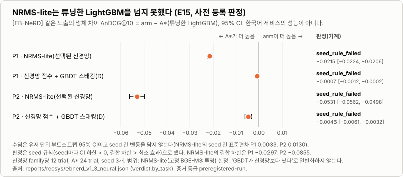

# 02. 네거티브 분포가 과제를 정한다: ablation, E15 음성 결과, train/serve parity

| | |
|---|---|
| 데이터 | [EB-NeRD] 덴마크어 공개 뉴스 클릭 로그 `ebnerd_small`(평가 24.5만 노출, 유저 1.5만). parity 절은 [CI-synth] |
| 증거 등급 | 승격 규칙 R1–R4 판정과 E15는 `preregistered-run`(판정 규칙을 결과 전에 커밋, 판정은 코드). ablation 단계의 서술('대부분이 네거티브에서 왔다', 'P2에서 뒤집힌다')과 P2 보충 실험(v1 결과를 본 뒤 등록)은 `descriptive`. parity는 `descriptive`(CI 게이트의 값) |
| 팀과 개인 | 팀 시절 추천 모델(LightGBM)과 MMR은 팀원의 작업이다. 이 글의 평가 하네스, ranker v2 설계, 피처 코어 `recsys_core`, parity 게이트는 팀 이후의 개인 작업이다 |
| 한 줄 | 랭커 개선의 대부분은 모델이 아니라 학습 네거티브(+0.1868 [+0.1844, +0.1893])에서 왔고, 같은 모델이 서빙형 과제에서는 인기도보다 낮다. 신경망(NRMS-lite) 대안은 사전 등록한 비교에서 튜닝한 LightGBM을 넘지 못했다(판정 `seed_rule_failed`) |

## 문제

팀 방식 LightGBM은 "클릭한 기사 대 7일 풀의 무작위 기사"를 가르도록 학습한다. 서비스가 실제로 푸는 일은 서빙 후보 풀 안에서 순위를 매기는 것이다. 학습 문제와 서빙 문제가 같은가? 같지 않다면, 어떤 개선이 진짜 개선인가? 그리고 학습에 쓴 피처와 서빙이 계산하는 피처가 갈라지면 오프라인 결과는 서빙에서 의미를 잃는다. 평가 결과가 서빙 경로까지 이어지는지도 따로 확인해야 했다.

## 사전 등록된 기대와 가설

사전 등록(결과 전 커밋) 문서에 적힌 것은 두 가지다.

1. **기대(검정 규칙 없음).** 팀 방식의 학습 분포(클릭 대 7일 풀 무작위 기사)는 서빙 분포(같은 목록에 함께 노출된 기사들 사이의 순서)와 다르다. 그래서 노출 비클릭 네거티브를 서빙에 맞는 쪽으로 보았다(ADR 0013 '검토한 대안'). 사전 등록 절에 있는 규칙은 ablation 해석 규칙(인접 단계 ΔnDCG@10의 CI로 기여·해로움·구분 불가)과 승격 규칙 R1–R4뿐이고, 이 기대를 검정하는 규칙은 없다.
2. **가설(E15).** 학습형 신경망 유저 인코더는 이 데이터 규모(유저 1.5만 명, 세션당 조회 4건 이하)에서 튜닝한 GBDT를 이기지 못할 것이다. 사전 등록(ADR 0013 A3.1)에 이 가설을 "GBDT가 이길 이유"로 미리 적었고, 신경망이 이기면 그 이득이 정보 덕인지 구조 덕인지 가르는 대조군까지 설계했다.

**결과를 본 뒤의 해석(사전 등록에 없던 서술).** "개선의 대부분은 모델·목적함수가 아니라 학습 네거티브와 피처에서 왔다"와 "네거티브가 과제를 정한다"는 사전 등록 절에 없고, 리포트 해석 문단과 ADR 0013 결과 절에서 처음 나온다. 사전 등록 문서가 서빙에 맞는 쪽으로 본 노출 비클릭 네거티브 모델은 노출 재정렬(P1)에는 강했지만 전체 풀(P2)에서는 인기도보다 낮았다. 기대와 반대 방향의 결과다. P2 피처 사슬은 v1 결과를 본 뒤에 별도로 등록한 보충 실험(ADR 0013 A1)이다.

## 측정 설계

- **프로토콜과 판정 규칙을 결과 전에 커밋**했다([ADR 0013](../adr/0013-ranker-v2-design.md)). 사전 등록 커밋 `d27a700`은 main 위로 옮기기 전의 SHA라 원격에서 열리지 않는다. 지금 이력의 [`1358afd`](https://github.com/khj1212k/pro-recsys-finalproject-recsys-01/commit/1358afd)가 같은 사전 등록 절이고, 대응과 push 시각 근거는 ADR 0013 통합 기록 1·2에 있다. 승격 규칙 R1–R4를 코드가 JSON에서 계산한다.
- **7개 모델의 ablation 사슬**: 팀 방식 → LambdaRank(유저 그룹) → 노출 그룹 → 노출 비클릭 네거티브 → + trailing 인기도 → + 단기·세션 벡터 → + 카테고리 share·히스토리 길이. 3 seed, 유저 단위 부트스트랩 1,000회, 인접 단계는 같은 노출의 쌍체 차이로 본다.
- **두 과제**: P1은 편집자가 보여 준 노출 목록 안의 재정렬(24.5만 노출), P2는 요청 시각 기준 48시간 안에 발행된 기사 전부를 후보로 둔 랭킹(2만 요청, 평균 풀 235개)이다. P2가 서빙형 과제에 가깝다(이 서비스의 후보 풀은 설계상 45~90개로 EB-NeRD P2의 평균보다 작다).
- **E15**: 같은 과제·네거티브·콜드 증강을 두 학습기가 받고, 신경망 family당 12 trial, LightGBM A\*는 24 trial, seed 3개, 모델 선택에 test를 쓰지 않는다.
- **train/serve parity**: 서빙이 로그에 남긴 22열 피처를 같은 로그의 오프라인 재계산과 비교한다. CI가 PostgreSQL에서 요청 200건을 실제 라우터로 재생하고, 임계값(피처 max\|Δ\| < 1e-6, 요청별 순서 τ = 1 등)은 [ADR 0033](../adr/0033-train-serve-feature-parity.md)에 있다.

## 결과

노출 재정렬(P1)에서 ranker v2는 nDCG@10 0.6551 [0.6533, 0.6569]이고, popularity_24h 0.5992와 팀 방식 재현 0.3952를 모두 넘는다(R1 +0.0559, R2 +0.2598). 사전 등록한 승격 규칙 R1–R4는 통과했지만, R1·R2는 ranker_v2로, R3·R4는 풀 네거티브 변형 `ranker_v2_poolneg`로 판정했다. 한 모델이 P1과 P2를 모두 넘은 것은 아니다. 그런데 단계별로 쪼개면 이야기가 달라진다.

| 단계(P1, ΔnDCG@10 [95% CI]) | 값 |
|---|---|
| binary → LambdaRank(유저 그룹) | +0.0010 [+0.0008, +0.0012] |
| 무작위 → 실제 노출 비클릭 네거티브 | **+0.1868** [+0.1844, +0.1893] |
| + trailing 인기도 | +0.0571 [+0.0560, +0.0582] |
| + 단기·세션 벡터, + 카테고리 분포·히스토리 길이 | +0.0088, +0.0089 |

같은 모델을 전체 풀(P2)에서 재면 노출 비클릭 네거티브 단계가 −0.1307 [−0.1357, −0.1259]로 뒤집힌다. ranker v2는 0.0530 [0.0507, 0.0553]으로 popularity_6h 0.1168 [0.1132, 0.1203]보다 낮다. 같은 피처에 48시간 풀 무작위 네거티브를 쓴 `ranker_v2_poolneg`는 P2에서 0.2686 [0.2640, 0.2728](popularity_6h 대비 +0.1518)이고 P1에서는 무작위 수준(AUC 0.5025)이다. v1 결과를 본 뒤 등록한 보충 실험(A1)에서 네거티브를 48시간 풀로 고정하면 P2에서 trailing 인기도 +0.0494, 단기·세션 +0.0234, 카테고리 분포 +0.0147로 피처 단계가 모두 기여하고, 같은 팀 피처에서는 목적함수·네거티브 교체 효과가 없었다(0.1814 대 0.1812). 출처: [`ebnerd_v1` 4~5절·부록 A](../../reports/recsys/ebnerd_v1.md).

**E15, 신경망 대 LightGBM.** 판정 비교 4개가 모두 사전 등록한 seed 규칙을 통과하지 못했다(`seed_rule_failed`).

NRMS-lite는 P1에서 −0.0215 [−0.0224, −0.0206], P2에서 −0.0531 [−0.0562, −0.0498]이다. 신경망 점수를 GBDT에 넣은 스태킹(D)도 −0.0007, −0.0046으로 이기지 못했다. 판정이 말하는 것은 "우위를 입증하지 못했다"이고(주장 `none`, shadow 자격을 얻은 arm 없음), 열위를 판정하는 규칙은 사전 등록에 없었다. 네 비교의 점추정과 95% CI가 모두 0 아래라는 것은 기술 통계다. 튜닝과 증강의 몫은 거의 없었다(`A* − A` P1 +0.0005, P2 −0.0002). 출처: [`ebnerd_v1_3_neural`](../../reports/recsys/ebnerd_v1_3_neural.md), [ADR 0013 A3 결과](../adr/0013-ranker-v2-design.md).

**train/serve parity: 오프라인 결과를 서빙까지 잇기.** 피처 계산을 numpy만 쓰는 하나의 코어(`recsys_core`)로 두고 오프라인 하네스와 서빙 어댑터가 같이 쓰게 했다. 위 비교를 CI가 매번 돌린다.

| CI 실행 | 비교한 요청·칸 | 피처 max\|Δ\| | 요청별 Kendall τ(최소) | 판정 |
|---|---|---|---|---|
| 37388934917 (첫 실행) | 198 / 3,960 | 0.0397 | 1.0 | **실패** |
| 37389722931 (고친 뒤) | 198 / 3,960 | 1.19e-7 (기준 1e-6) | 1.0 | 통과 |

첫 실행의 실패는 진짜 어긋남이었다. 최근 20클릭만 쓰는 단기 피처를 서빙은 마이크로초 순으로, 오프라인 재계산은 정수 초 순으로 골라서 같은 초에 클릭이 몰린 경계에서 서로 다른 클릭이 남았다. 순서 키를 (초, 뉴스레터 ID)로 고정해 닫았다 ([parity_v1](../../reports/recsys/parity_v1.md), [ADR 0033](../adr/0033-train-serve-feature-parity.md)).

## 결정

1. **서빙 모델은 서빙형 과제의 네거티브로 학습한 쪽을 골랐다.** P1의 0.6551만 보면 ranker v2가 이긴다. 하지만 서빙은 P2 쪽 조건이고 거기서는 인기도보다 낮다. 그래서 검증셋을 보지 않는 사전 등록 규칙(early-stop 구간 표본)으로 풀 네거티브 계열(`ranker_v2_poolneg`)을 선택했고, 서빙은 shadow부터 시작한다고 못 박았다. 콜드 regime 실행(A2) 뒤 shadow 주모델은 `poolneg_mask0`로 바뀌었다.
2. **피처 계산을 한 구현으로 통일하고 parity를 CI 게이트로 만들었다.** 두 구현을 사람이 맞추는 방식은 실제로 어긋났다(위 0.0397). 게이트의 임계값(피처 max|Δ| < 1e-6, 요청별 순서 τ = 1, 랭커 상위 20개 겹침 평균 ≥ 0.9, 후보 구성 동일)은 ADR 0033이 정했고, 어긋남이 생기면 빌드가 실패한다.
3. **신경망 비교를 사전 등록하고, 넘지 못한 결과를 그대로 남겼다.** 판정을 코드에 맡겼고, 기각의 범위를 [EB-NeRD]와 NRMS-lite(고정 BGE-M3 투영)로 좁혀 적었고, 결과와 무관하게 후속 실험을 하지 않기로 했다(A3.12). 이 결과가 서빙 코드와 등록 모델을 바꾸지 않는다. LightGBM 유지의 근거다.

## 한계

- 덴마크 타블로이드 한 곳, 1주 평가 창, split 하나다. 한국어 전이는 확인하지 않았다. 랭크 정규화 계약은 E3에서 불충족이었다(−0.0144 [−0.0171, −0.0118]).
- EB-NeRD에는 클릭 시각이 없어 노출 시각으로 근사했다. 이 서비스의 진짜 서빙 성능은 P1과 P2 수치 사이 어딘가이고, 이 데이터만으로는 가를 수 없다.
- ranker v2의 인기도 베이스라인 대비 우위는 +0.0559로 작고 gain 상위가 인기도 피처(`pop_clicks_6h` 26%, `pop_ctr_24h` 22%)라서, 인기도 신호가 약한 초기 서비스에는 그대로 옮겨지지 않는다.
- E15는 신경망 family당 12 trial 대 A\* 24 trial의 예산 비대칭이 있고, 스태킹의 손실이 학습 행 수 감소 탓인지 정보 부족 탓인지는 이 실험에서 가려지지 않는다. test 창이 앞선 실험에서 여러 번 보고되어 A·A\*·A+의 피처 구성에 유리한 방향이다. "GBDT가 신경망보다 낫다"는 [EB-NeRD]·NRMS-lite 한정으로만 쓴다.
- parity 게이트가 쓰는 모델은 무작위 데이터의 22열 모델이다. 서빙 정의와 EB-NeRD 학습 정의의 차이는 측정하지 않았다.
- **서빙 경로에 연결된 범위.** 활성 휴리스틱 스코어러 v2([ADR 0014](../adr/0014-active-heuristic-scorer-v2.md))가 목록을 만들고, 랭커는 요청 경로 밖에서 점수만 남기는 shadow 경로까지 코드가 있다. shadow 등록 도구와 테스트까지만 있고([ADR 0037](../adr/0037-ebnerd-shadow-model-registration.md)), 서빙 API가 배포되어 있지 않아 등록된 랭커와 shadow 점수는 아직 없다.

## 링크

- 리포트: [`ebnerd_v1`](../../reports/recsys/ebnerd_v1.md) · [`ebnerd_v1_2_cold`](../../reports/recsys/ebnerd_v1_2_cold.md) · [`ebnerd_v1_3_neural`](../../reports/recsys/ebnerd_v1_3_neural.md) · [`parity_v1`](../../reports/recsys/parity_v1.md)
- 결정: [ADR 0013](../adr/0013-ranker-v2-design.md) · [0031](../adr/0031-cold-start-and-language-transfer-contract.md) · [0033](../adr/0033-train-serve-feature-parity.md) · [0014](../adr/0014-active-heuristic-scorer-v2.md) · [0037](../adr/0037-ebnerd-shadow-model-registration.md)
- 이전 편: [01. 팀 지표 누출 규명](01-team-metric-leakage.md) · 다음 편: [03. LLM 생성 첫 실측](03-first-llm-measurement.md) · 전체 증거: [증거 요약표](../evidence-summary.md)
